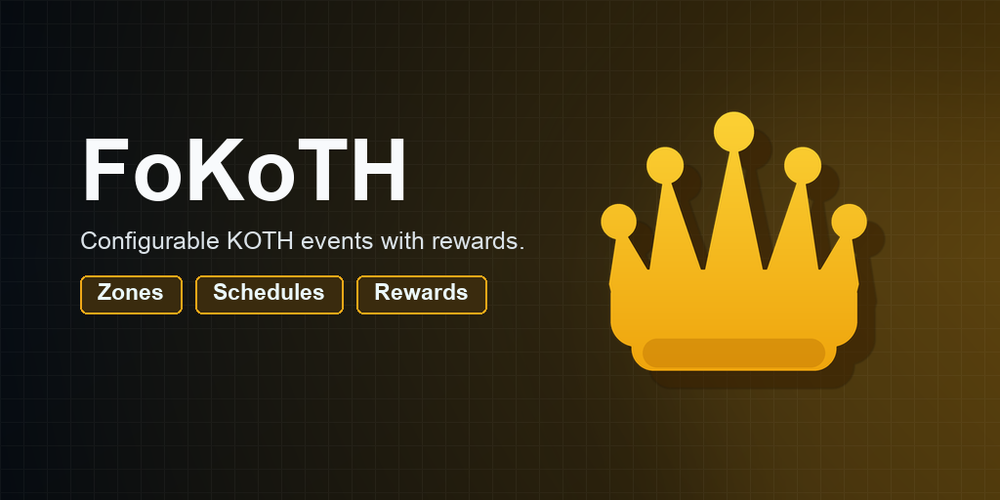
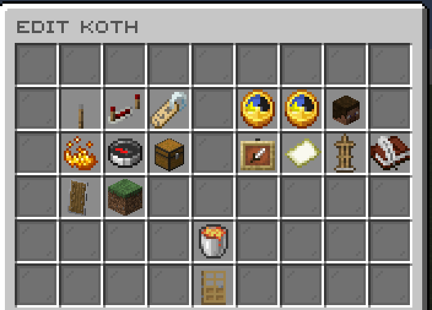
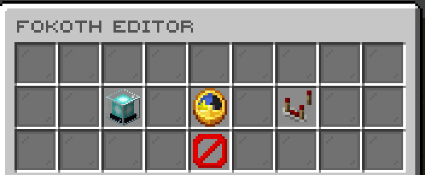
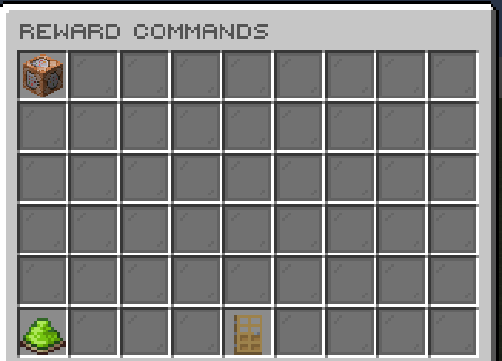
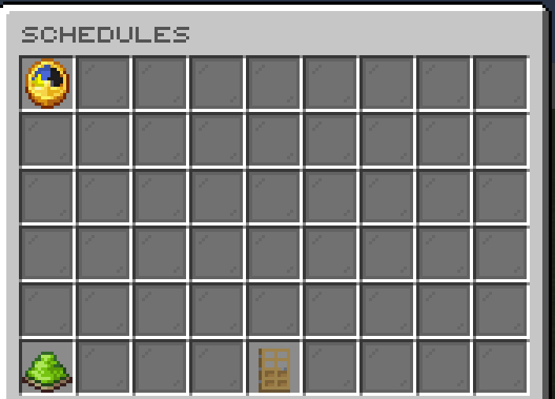
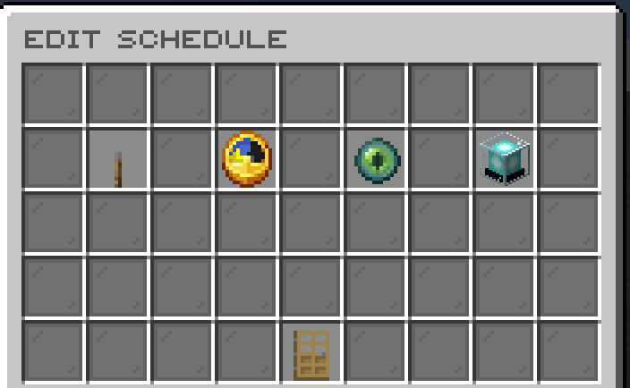

# FoKoTH

[](https://modrinth.com/plugin/fokoth) [](https://modrinth.com/plugin/fokoth/versions) [](https://discord.gg/kEF77QCfu7)

Scheduled King of the Hill events with rewards and team integrations.

*Developed by Carrotio.*

## Features

- Runs configurable King of the Hill capture events.
- Supports schedules, rewards, score gain, and timed capture progress.
- Integrates with a broad range of team, faction, clan, and party plugins.
- Provides editor screens for hills, schedules, and reward commands.
- Exposes lifecycle Bukkit events and detailed PlaceholderAPI values.

## Download and dependencies

Download the latest compatible version from [Modrinth](https://modrinth.com/plugin/fokoth). Check the [versions page](https://modrinth.com/plugin/fokoth/versions) for supported Minecraft versions and server platforms.

- **Required:** None
- **Optional integrations:** `PlaceholderAPI`, `BattlePass`, `BetterTeams`, `Factions`, `FactionsUUID`, `GangsPlus`, `Guilds`, `Kingdoms`, `SuperiorSkyblock2`, `Towny`, `UltimateClans`, `Parties`, `AxParties`, `ZelTeams`, `FoTeams`

## Screenshots



*Edit a KOTH event.*



*Manage KOTH settings in game.*



*Configure reward commands.*



*Browse event schedules.*



*Edit a schedule.*

## Support

For help or issue reports, join the [Carrotio Discord server](https://discord.gg/kEF77QCfu7).

<details>
<summary><strong>Commands and permissions</strong></summary>

### Commands

- `/fokothadmin <version|reload|editor|list|info|start|stop>` — FoKoTH admin command. Aliases: `/kothadmin`, `/fokoth`, `/koth`.

### Permissions

- `fokoth.admin` — Access FoKoTH admin tools. Default: `op`.

</details>

<details>
<summary><strong>PlaceholderAPI</strong></summary>

Requires PlaceholderAPI.

- `%fokoth_player_wins%` — Player's recorded KOTH wins.
- `%fokoth_team_wins%` — Player team's recorded KOTH wins.
- `%fokoth_next% / %fokoth_next_formatted%` — Time until the next scheduled KOTH.
- `%fokoth_next_<schedule>% / %fokoth_next_<schedule>_formatted%` — Time until a named schedule.
- `%fokoth_<koth>_active%` — Whether the named KOTH is active.
- `%fokoth_<koth>_name% / %fokoth_<koth>_display_name%` — Configured identifier or display name.
- `%fokoth_<koth>_world% / %fokoth_<koth>_x% / %fokoth_<koth>_y% / %fokoth_<koth>_z%` — Configured capture location.
- `%fokoth_<koth>_capturer_name% / %fokoth_<koth>_capturer_team_name%` — Current capturer information.
- `%fokoth_<koth>_time_left% / %fokoth_<koth>_time_left_formatted%` — Remaining capture time.
- `%fokoth_<koth>_max_time_left% / %fokoth_<koth>_max_time_left_formatted%` — Remaining maximum event time.

</details>

<details>
<summary><strong>Configuration</strong></summary>

- `config.yml` — Main behavior and feature settings.
- `messages.yml` — Player-facing messages and interface text.
- `schedules.yml` — KOTH schedule definitions.
- `sounds.yml` — Configurable interaction sounds.
- `koths/*.yml` — KOTH definitions.

Main config areas: `native-dialogs`, `features`, `discord-webhook`, `storage`, `hooks`, `hook-settings`, `timer-format`, `capture-broadcast-every-seconds`.

</details>

<details>
<summary><strong>Developer API</strong></summary>

FoKoTH 1.7 exposes Bukkit events and a `FoKothApi` service. Compile against the matching FoKoTH jar as a **provided** dependency; do not shade its classes into a consumer. The jar is produced by `mvn clean package` as `target/FoKoTH-1.7.jar`. No public Maven repository is assumed. If needed, install that jar in the consumer's local Maven repository with `mvn install:install-file -Dfile=/path/to/FoKoTH-1.7.jar -DgroupId=me.foesio -DartifactId=FoKoTH -Dversion=1.7 -Dpackaging=jar`.

```xml
<dependency>
    <groupId>me.foesio</groupId>
    <artifactId>FoKoTH</artifactId>
    <version>1.7</version>
    <scope>provided</scope>
</dependency>
```

Use `depend: [FoKoTH]` in a Bukkit `plugin.yml` when required, or `softdepend: [FoKoTH]` when optional. For an optional integration, check whether FoKoTH is enabled before loading a separate integration class that directly references `me.foesio.foKoTH.api` types. Obtain the service after both plugins enable:

```java
FoKothApi api = Bukkit.getServicesManager().load(FoKothApi.class);
if (api != null) {
    HillStatus hill = api.hill("spawn");
    if (hill != null && !hill.active()) {
        KothActionResult result = api.start("spawn");
    }
}
```

The service is registered after FoKoTH initializes and removed on disable. Reacquire it after a plugin restart; do not use a cached service once FoKoTH is disabled. `hill(id)` returns `null` for an unknown ID, and `hills()` includes configured inactive hills. `HillStatus` is a point-in-time snapshot: its score map is immutable; IDs and mode are strings; coordinates are copied primitives; `capturer` is a UUID or `null`. `captureProgressSeconds` applies only to CAPTURE mode. `winThreshold` is hold seconds in CAPTURE mode, score points in SCORE mode, and can be negative for an unlimited score target. `eventSecondsRemaining` is `-1` when inactive or unlimited. Score keys are player UUID strings or `TEAM:` plus a lowercase team name. A new query is required for fresh state.

`start(id)` uses the admin start rule: configured/enabled/valid hills only, one run per ID, and no minimum-player gate. It returns `STARTED`, `NOT_FOUND`, `DISABLED`, `INVALID_ZONE`, `ALREADY_ACTIVE`, or `CANCELLED`; `stop(id)` returns `STOPPED`, `NOT_FOUND`, or `NOT_ACTIVE`. Both return `PLUGIN_DISABLED` when FoKoTH is disabled. A successful API start/stop runs the same commands, broadcasts, event calls, and cleanup as built-in starts/stops. An unchanged or rejected request fires no start/stop event. The API does not check a caller player's permission; only server plugins can obtain the service.

For custom team plugins, call `registerTeamResolver(owner, "myguilds", player -> ...)`, then set `hooks.team-plugin: myguilds` in FoKoTH's config and reload FoKoTH. Keep `features.team-hooks: true`. IDs use letters, digits, `_`, or `-`; built-in names are reserved. The selected resolver determines score grouping, team display, and team win identity. Return a stable team name, or blank/null for no team. One owner can replace its own resolver for an ID; a different enabled owner cannot take it. `unregisterTeamResolver(owner, id)` removes only that owner's resolver. If the selected resolver is absent, disabled, or throws, FoKoTH falls back to the Bukkit scoreboard team. Resolver registration does not edit config or persisted data.

For an external participation condition, call `registerParticipationRule(owner, (hillId, player) -> trueOrFalse)`. Every registered, enabled owner's rule must allow the player. FoKoTH checks rules only for otherwise eligible players inside a hill's zone during each one-second hill tick; a current holder may be checked again in that tick. A rejected current holder loses capture as they would on leaving the zone. Registration replaces that owner's prior rule; `unregisterParticipationRule(owner)` removes it. An exception is logged once per owner and treated as allow, so a faulty integration cannot stall the event. Registrations are removed when the owner plugin disables. Keep callbacks quick and free of blocking I/O.

These API methods and callbacks use FoKoTH's server tick context. Do not call them asynchronously. FoKoTH's timers use the global scheduler on regionized servers, but player-region access and event context have not been validated on Folia; consumers must not assume Folia safety from this API alone. Query calls throw `IllegalStateException` after FoKoTH disables; registration of a participation rule does too.

### Bukkit events

Every event is in `me.foesio.foKoTH.api.event`, is synchronous under Bukkit's event flag, and provides `getKothName()`. Existing constructors and `isNaturalEnd()` remain available.

| Event | Timing and meaning |
| --- | --- |
| `FoKothPreStartEvent` | After hill validity and minimum-player checks; before active state, commands, broadcast, or starter-item consumption. `getCause()` is `COMMAND`, `STARTER`, `SCHEDULE`, or `API`; `getStarter()` is non-null for starter items. Cancel to reject the start without hill side effects. A cancelled schedule occurrence remains consumed for that cron minute. |
| `FoKothStartEvent` | After the active hill is inserted; before start commands, broadcast, sound, and hologram spawn. |
| `FoKothCaptureStartEvent` | After a player becomes the current holder; before capture-start commands and broadcast. |
| `FoKothCaptureEndEvent` | Before a lost holder is cleared; it occurs on death, leaving the zone, or replacement. Ending the entire hill does not separately emit this event. |
| `FoKothGainScoreEvent` | After a score-mode point is added; `getScore()` is the new total for that player or team key. |
| `FoKothCapturedEvent` | A winner was selected in either mode, **before** the win cache, asynchronous database write, rewards, broadcast, and stop event. It does not mean durable persistence succeeded. |
| `FoKothStopEvent` | After stop state and configured end commands; before display cleanup. `getReason()` is `WIN`, `TIMEOUT`, `MANUAL`, `API`, `DELETED`, `RELOAD`, or `SHUTDOWN`. `isNaturalEnd()` stays true only for wins and timeouts. The old boolean constructor maps true to `TIMEOUT` and false to `MANUAL`. |

All events are notifications except `FoKothPreStartEvent`. Changing player state from a listener may affect the remainder of the current tick; schedule follow-up work through the appropriate server scheduler.

### Event listener example

Inside a Bukkit `Listener` registered by your plugin (import this event class, `org.bukkit.event.EventHandler`, and `org.bukkit.Bukkit` where used):

```java
@EventHandler
public void onFoKothPreStart(FoKothPreStartEvent event) {
    Bukkit.getLogger().info("Starting hill: " + event.getKothName());
}
```

### Complete public API method index

Signatures use short type names; import Fo types from this plugin's `api` package and Bukkit types from Bukkit.

#### `FoKothApi`

```java
Collection<HillStatus> hills();
HillStatus hill(String);
KothActionResult start(String);
KothActionResult stop(String);
boolean registerTeamResolver(Plugin, String, TeamResolver);
void unregisterTeamResolver(Plugin, String);
void registerParticipationRule(Plugin, ParticipationRule);
void unregisterParticipationRule(Plugin);
```

#### `TeamResolver`

```java
String teamName(Player);
```

#### `ParticipationRule`

```java
boolean mayContest(String, Player);
```

**Other public contract types:** `HillStatus`, `KothActionResult`.

### Complete Bukkit event index

- `FoKothCaptureEndEvent`.
- `FoKothCaptureStartEvent`.
- `FoKothCapturedEvent`.
- `FoKothEvent` — abstract base for related events.
- `FoKothGainScoreEvent`.
- `FoKothPreStartEvent`.
- `FoKothStartEvent`.
- `FoKothStopEvent`.

</details>
